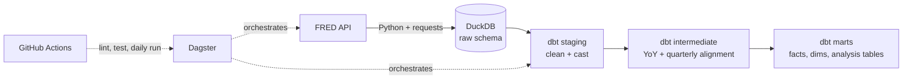

# FRED Macroeconomic Data Pipeline


## Project Brief:
This project demonstrates an orchestrated, tested ELT pipeline that ingests U.S. economic data from the Federal Reserve's FRED API. This model is stored within a 3 layer dbt warehouse and looks into **how workers' wages keep up with inflation trends, and how do labor markets differ across states.** This pipeline is designed to run daily, rebuilds from scratch in CI on every push, and includes a blocking data quality check that prevents unclean data from reaching the analytics layer. 

## Quick Author's note:
This project was also inspired by my internship at Federato, where I learned SO much about desinging models in a dbt medalian architecture, writing tests to catch errors and how analytics is heavily reliant on the data structures beneath it. Additionally, I just finished a BS in DS and Econ, so I wanted to do another project that brought those two halves together (shocker lol). 

TLDR: this project applies the modeling practices that I learned on the job to the economic data that I often referenced in school, it extends them with orchestration and CI/CD, tools that I wanted to dive into further to learn more about data engineering!


## Impact: 
Economic data is a arguably a difficult data engineering problem. There are constant changes as FRED revises previously published values as new data or more complete data arrives. Additionally, these series come with different time granularity (for example: monthly CPI vs quarterly GDP), and something such as an API failure can leave analytics with incomplete numbers or stale data without flagging.

This project aims to handle these problems a way that:

- Revisions are captured with incremental loads that re-pull a lookback window and upsert on a primary key, so restated values overwrite stale ones without creating duplicates.
- Frequency mismatches are resolved in an intermediate layer that aligns monthly series to quarters and flags incomplete periods instead of silently averaging partial data.
- Silent failures are caught by a blocking asset check: if any series fails to load, Dagster **halts** the dbt build, and the marts keep the last good data.
- Reproducibility is proven by CI, which rebuilds the entire warehouse from the source API on a fresh machine for every push and pull request.

## Key findings (from model run in October 2026)

*As of September 2026 data. Wages are average hourly earnings for all private employees; inflation is year-over-year CPI.*

- 2021–2023 was the worst stretch for real wages since the wage series begins. Real wage growth turned negative in April 2021 and stayed negative for **25 consecutive months**, through April 2023. That is longer than the 15-month stretch in 2011–2012 and the 13-month stretch during the 2007–2008 financial crisis.

- The disparity between inflation and wages peaked in June 2022. Inflation reached **8.98%** while wages grew **5.40%**, a real decline of 3.58%. Workers were earning more in dollar terms but could afford less.

- Real wages are slipping again. In September 2026, inflation of 3.72% outpaced wage growth of 3.02%, putting real wage growth at −0.69%. The decline is far smaller than in 2022, but wages are once again falling behind prices.

- State labor markets are mostly tracking the national rate, with one exception. All four tracked states sit above the national unemployment rate of 4.2%. Massachusetts and New York are within 0.1 percentage points, Texas is 0.2 points above, and California stands out at 5.1%, 0.9 points above the national rate.

## Tech stack

Python, DuckDB, dbt, dagster, github actions, ruff, SQL Fluff


## Model Architecture 




## Layers / Tools:
- Ingestion | Python 'requests': this pulls 10 FRED series incrementally
- Storage | DuckDB: Single-file analytical warehouse with `raw`, `staging`, `intermediate`, and `marts` schemas
- Transformation | dbt: Three-layer models with schema and custom tests and source freshness checks
- Orchestration | Dagster: Runs ingestion and dbt as one asset graph, with a blocking quality check and a daily schedule
- CI/CD | GitHub Actions: Lints Python and SQL, runs the full pipeline on every push and PR, and runs daily in the cloud


### Lineage

DBT Lineage graph and Dagster Asset graph can be found in docs/images folder!!!

## Data model

The warehouse follows the same three-layer pattern: staging, intermediate, and marts. Each layer has a different degree of data cleanliness, the final layer being analytics ready!

**Staging** is where the raw API data gets cleaned up. FRED sends every value as text and uses a `"."` for missing data, so this layer converts values to numbers and turns those placeholders into proper nulls.

**Intermediate** is where the data gets reshaped for analysis. 
- `int_observations_yoy` calculates year-over-year change for every series. 
- `int_observations_quarterly` averages monthly data into quarters so it can sit next to GDP, which is only reported quarterly. It also flags quarters that aren't finished yet.

**Marts** analytics ready tables:

Models:
- dim_series: A reference table describing each series: its name, units, and how often it's reported
- fct_economic_observations: Every value for every series and date, with its year-over-year change
- mart_real_wage_growth: Whether wages are keeping up with inflation, month by month
- mart_state_labor_market: How each state's unemployment rate compares to the national rate
- mart_quarterly_macro: GDP, unemployment, and interest rates side by side for each quarter 


## Data quality

This pipeline includes checks at each stage, to flag any errors or failures.

- If `all_series_loaded` check fails, and Dagster stops before dbt runs
- Once data is in the warehouse, dbt tests confirm that the basics hold: every key is unique and present, every series has an expected frequency, and every row in the fact table links to a series in the dim table
- A custom test also checks that unemployment rates stay between 0 and 100, since anything outside that range means something broke upstream.
- dbt also watches for data staleness. It warns if raw data hasn't been updated in 3 days and raises an error after 7.
- Pipeline is rerun-able. multiple ingestions doesn't create duplicate rows, and uniqueness test inplace for 'observation_id'


## How to run this yourself!

1. You DEF need: at least python 3.11 and a FRED API key (dw its free) get yours here: https://fred.stlouisfed.org/docs/api/api_key.html

2. clone me! 
```type this in your terminal:
git clone https://github.com/abigailvalladolid/FRED-macro-pipeline.git
cd FRED-macro-pipeline
python -m venv .venv
source .venv/bin/activate
pip install -r requirements.txt
echo "FRED_API_KEY=your_key_here" > .env   # replace with your api key
```

3. How to run the pipeline with Dagster:
```in terminal: 
export DAGSTER_HOME=$(pwd)/.dagster_home
mkdir -p $DAGSTER_HOME
dagster dev -m orchestration.definitions
```
Open http://localhost:3000 (or whatever link it gives you) and click *Materialize all*.


## recap of hte project structure
```
FRED-macro-pipeline/
├── ingestion/
│   └── ingest_fred.py          # incremental FRED ingestion with upserts
├── fred_dbt/
│   ├── models/
│   │   ├── staging/            # cleaning and casting
│   │   ├── intermediate/       # YoY change and quarterly alignment
│   │   └── marts/              # facts, dimensions, and analysis tables
│   ├── tests/                  # custom data tests
│   └── profiles.yml            # portable DuckDB connection
├── orchestration/
│   └── definitions.py          # Dagster assets, check, job, and schedule
├── .github/workflows/ci.yml    # lint, full pipeline run, daily schedule
└── requirements.txt
```

## Future work:

- Perhaps expand this to track full revision history using FRED's vintage data (ALFRED).
- Perhaps put this into a dashboard!
- Look more into state coverage and add regional inflation series.
- Get a new laptop with more storage to do more DE projects :/


## Resources & documentation
- FRED API documentation: (https://fred.stlouisfed.org/docs/api/fred/)
- Get your api key here: (https://fred.stlouisfed.org/docs/api/api_key.html) 
- FRED series observations enpoint: (https://fred.stlouisfed.org/docs/api/fred/series_observations.html)
- dbt structure (staging, int, marts): (https://docs.getdbt.com/best-practices/how-we-structure/1-guide-overview) 
- dbt data tests: (https://docs.getdbt.com/docs/build/data-tests)
- Kimball dimensional modeling techniques: (https://www.kimballgroup.com/data-warehouse-business-intelligence-resources/kimball-techniques/dimensional-modeling-techniques/)
- DuckDB documentation: https://duckdb.org/docs/
- DuckDB INSERT statement: https://duckdb.org/docs/sql/statements/insert
- Dagster documentation: https://docs.dagster.io/
- Dagster & dbt integration: https://docs.dagster.io/integrations/libraries/dbt
- Ruff: https://docs.astral.sh/ruff/
- SQLFluff: https://docs.sqlfluff.com/